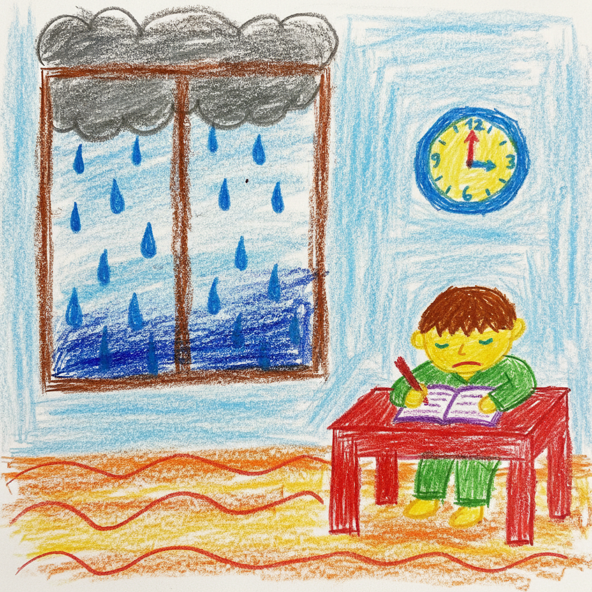

# 오늘의 일기

오늘은 아침부터 비가 왔다. 창문에 빗방울이 톡톡 부딪히는 소리에 잠이 깼는데, 시계를 보니 아침 6시였다. 평소보다 일찍 일어나서 조금 졸렸지만, 7시에 수업이 있어서 다시 잘 수는 없었다.

세수를 하고 간단히 아침을 먹은 다음 수업 준비를 했다. 비가 와서 그런지 밖은 어둡고 조용했다. 7시에 수업이 시작됐을 때는 아직 눈이 반쯤 감겨 있었는데, 수업을 듣다 보니 점점 잠이 깼다.

방학인데도 이렇게 일찍 일어나서 공부하니까 조금 힘들었다. 그래도 아침 시간을 잘 쓴 것 같아서 뿌듯했다. 빗소리를 들으면서 공부하니까 마음도 차분해지는 것 같았다.

내일은 비가 그쳐서 밖에서 놀 수 있으면 좋겠다.
