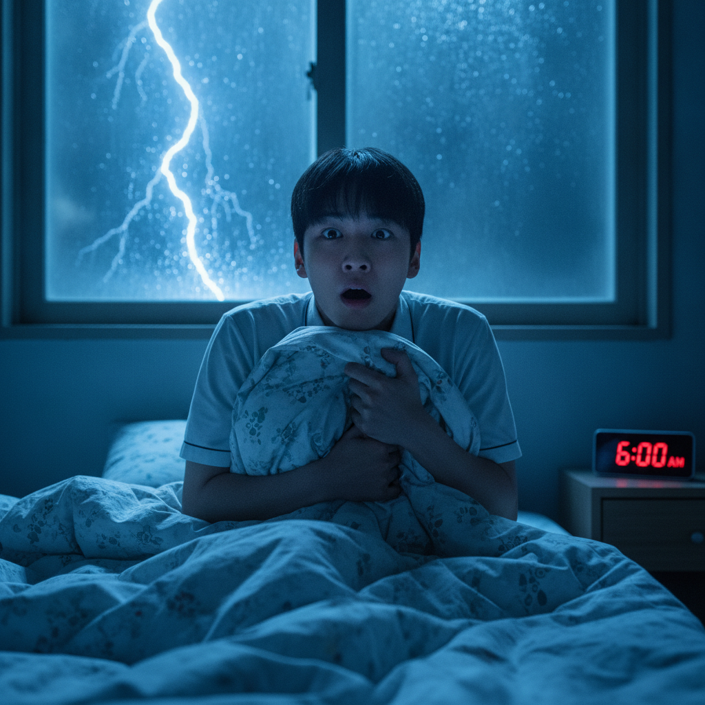
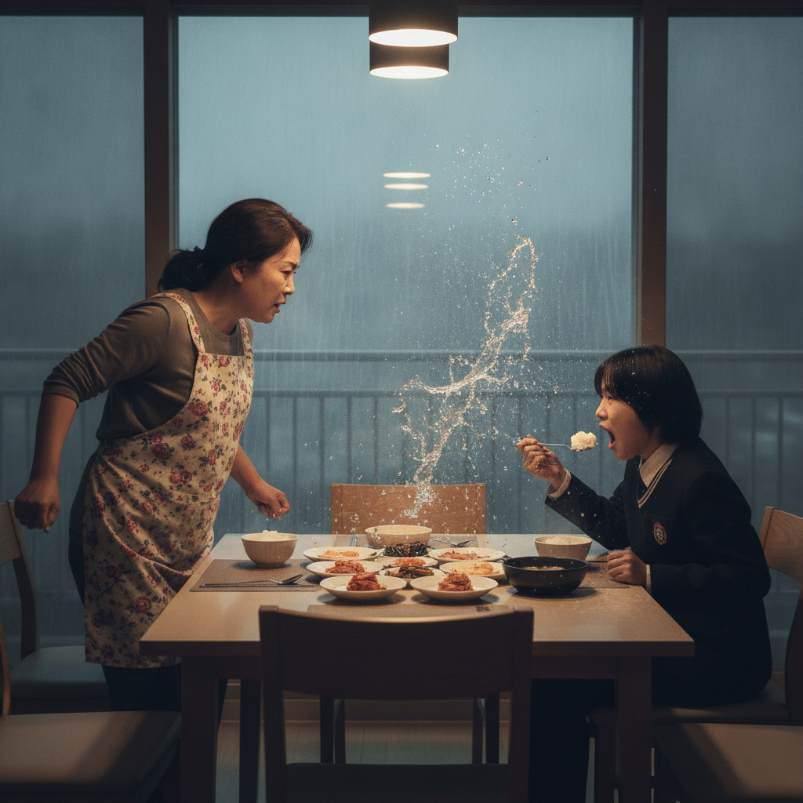
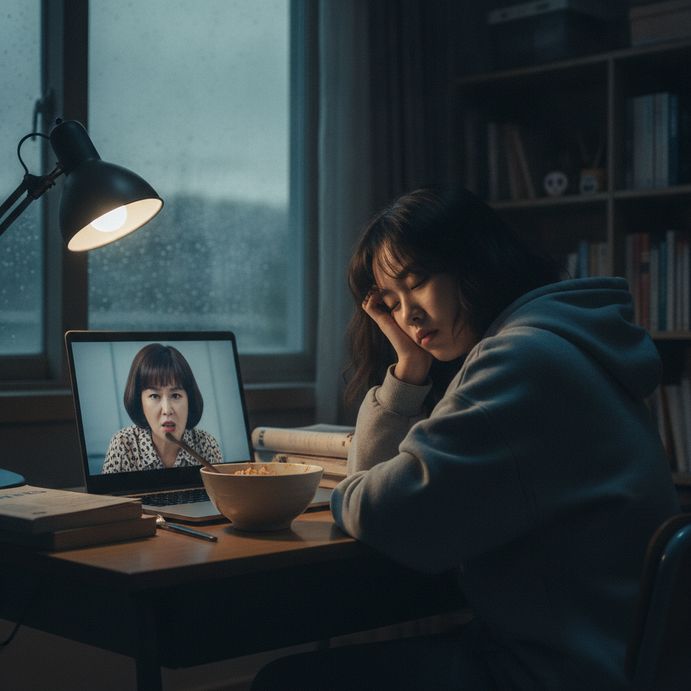
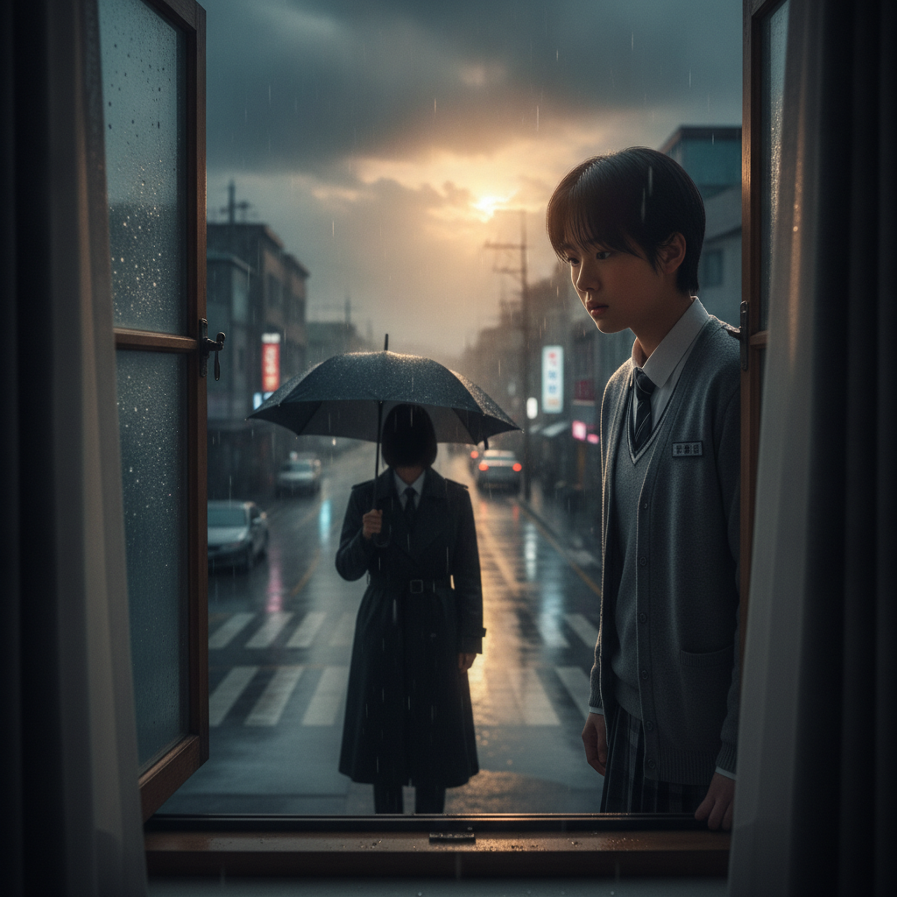

# 🌧️ 비 내리는 새벽, 그날의 진실 🌧️

> **주말 특별기획 막장드라마 〈새벽 6시의 배신〉 제1화**
> *"방학이라 믿었다. 그러나 운명은 7시에 수업을 잡아두었다…"*

---

## 🎬 #1. 새벽 6시, 운명의 빗방울

*(쾅! 천둥 효과음. 카메라가 창문으로 급격히 줌인)*

**톡. 톡톡. 톡톡톡톡.**

창문을 두드리는 빗방울 소리에 나는 눈을 번쩍 떴다.

> **나:** "누구야…! 이 새벽에… 누가 내 창문을 두드리는 거야!"

*(빗방울 클로즈업. 아무도 대답하지 않는다.)*

떨리는 손으로 시계를 돌아봤다. 빨간 숫자가 냉정하게 빛나고 있었다.

**오전 6시 00분.**

> **나:** "말도 안 돼… 평소보다 한 시간이나 일찍… 이건 꿈이야… 꿈이어야만 해…!"

다시 이불 속으로 들어가려던 그 순간, 머릿속을 스치는 한 문장.

***"7시에… 수업이 있다."***

*(배경음악: 비장한 바이올린 ♪♬ 화면 3분할로 주인공 얼굴 반복 클로즈업)*

다시 잘 수는… **없었다.**

---

## 🎬 #2. 아침 식탁의 진실

세수를 했다. 차가운 물이 얼굴에 닿는 순간, 거울 속의 나는 낯설었다.

> **나 (거울을 보며):** "너… 정말 방학 중인 학생 맞니…?"

식탁에 앉아 간단히 아침을 먹기 시작했다. 숟가락을 드는 순간, 엄마가 조용히 입을 열었다.

> **엄마:** "…너, 아직도 모르는구나."
>
> **나:** "뭘요, 엄마?"
>
> **엄마 (벌떡 일어나며):** "방학이라고 다 쉬는 줄 알았니?! 그 7시 수업… 네가 태어나기 전부터 정해져 있던 거야!!"

***촤아아악——!!!***

*(물컵의 물이 슬로모션으로 허공을 가른다)*

> **나 (밥숟가락을 든 채 얼어붙어):** "어, 엄마… 그게 무슨…"
>
> **엄마 (눈물을 글썽이며):** "다 너 잘되라고 그런 거다… 어서 밥 먹고 수업 준비해."

나는 떨리는 손으로 계란 프라이를 마저 먹었다. 창밖의 비는 더욱 거세졌다.

밖은 **어둡고**… **조용했다.** 마치 이 집안의 비밀처럼.

---

## 🎬 #3. 7시, 피할 수 없는 수업

7시 정각. 수업이 시작됐다.

내 눈은 아직 반쯤 감겨 있었다. 화면 너머의 선생님이 갑자기 카메라 쪽으로 몸을 기울였다.

> **선생님:** "…거기, 학생."
>
> **나 (화들짝):** "네, 네?!"
>
> **선생님 (눈을 가늘게 뜨며):** "지금… 졸고 있었나요? 아니면… **눈을 감고 생각하고 있었던 건가요?**"
>
> **나:** "……생각하고 있었습니다."
>
> **선생님:** "…좋아요. 그 눈빛. 어디서 많이 본 눈빛이군요."

*(선생님 의미심장한 미소. 효과음: 띠링—)*

그런데 이상했다. 수업을 들으면 들을수록, 잠이 **점점** 깨기 시작했다.

> **나 (속마음):** "이 느낌은 뭐지… 내 안에서 무언가가… 깨어나고 있어…!"

---

## 🎬 #4. 빗소리 속의 각성

방학인데도 이렇게 일찍 일어나 공부하는 건 **고통**이었다. 하지만 나는 포기하지 않았다.

> **나 (주먹을 꽉 쥐며):** "남들이 다 잘 때… 나는 공부한다. 그게 나의 복수다."

*(빗소리 ASMR과 함께 펜이 사각사각 움직이는 슬로모션 몽타주)*

빗소리를 들으며 공부하니, 이상하게도 마음이 **차분해졌다.**

분노도, 졸음도, 물벼락의 상처도… 빗물에 씻겨 내려가는 것 같았다.

> **나 (내레이션):** "오늘 아침… 나는 시간을 이겼다. 그리고 뿌듯했다."

---

## 🎬 #5. 엔딩 — 비가 그치면

수업이 끝나고 창문을 열었다. 먹구름 사이로 한 줄기 햇빛이 비치기 시작했다.

> **나 (하늘을 올려다보며):** "내일은… 비가 그쳤으면 좋겠다. 밖에서… 마음껏 놀 수 있도록."

그때였다.

젖은 거리 저편, **검은 우산을 쓴 누군가**가 우리 집 창문을 조용히 올려다보고 있었다.

> **나:** "……누구지?"

*(인물의 얼굴은 끝내 보이지 않는다)*

*(쾅!! 화면 정지. 흑백 전환.)*

---

> ### 📺 다음 이 시간에…
>
> - 내일, 정말 비는 그칠 것인가?
> - 검은 우산의 정체는 누구인가?
> - 엄마가 숨겨온 **"7시 수업의 비밀"**, 그 전말이 밝혀진다!
>
> **〈새벽 6시의 배신〉 제2화 — "맑음, 그러나 미세먼지"**
>
> *"너… 설마 내일 6시에도 일어날 생각이니…?"*

---

*※ 이 드라마는 실제 일기를 바탕으로 각색되었으며, 엄마는 실제로 물을 뿌리지 않았습니다.*
